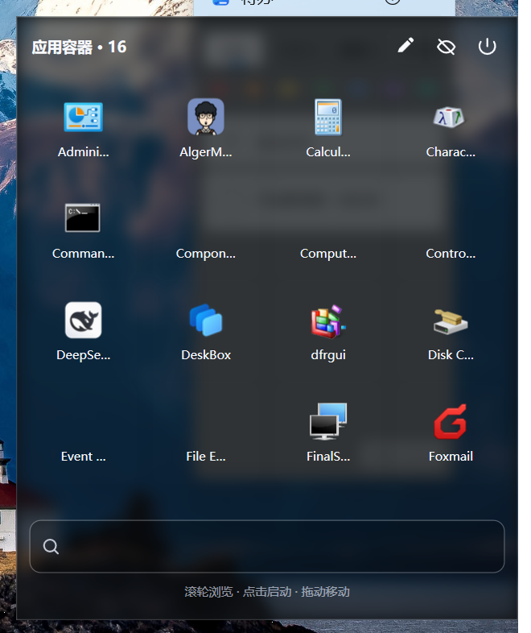

# DesktopDock

**把常用程序收进桌面上一个高斯玻璃面板：4×4 图标网格 + 内置搜索。**

[English](#english) · 中文



平时就是一个深色玻璃面板，点图标直接启动程序，输入名字即时搜索，
滚轮滑动浏览更多，拖到哪它就在哪。

---

## 下载

| 方式 | 命令 / 操作 | 说明 |
|---|---|---|
| **ZIP（推荐）** | 点页面右上角 **Code → Download ZIP**，解压后双击 `launcher.vbs` | 包含全部文件和示例配置，最省事 |
| git 克隆 | `git clone https://github.com/Landman-Chio/DesktopDock.git` | 方便后续 `git pull` 更新 |
| 单个文件 | 打开文件 → 点 **Raw** | 也能用，但会**缺少 `config.example.json` 示例配置** |

> 已验证：单独下载的 `.vbs` 文件（即便行尾被转成 LF）也能正常双击运行。

---


## 特性

| 特性 | 说明 |
|---|---|
| **高斯玻璃** | 面板背后是真模糊，不是单纯半透明（实现见下） |
| **4 × 4 网格** | 每行 4 个、可见 4 行；更多应用用滚轮滑出来 |
| **搜索栏** | 第 5 行；搜的是**全部已安装应用**，不只是面板里显示的 |
| **图标按钮** | 标题栏三个矢量图标：编辑 ✎ / 隐藏 ◡ / 退出 ⏻ |
| **拖动** | 按住面板空白处或标题栏拖走，位置自动记住 |
| **自定义顺序** | 编辑器里 ▲▼ 调整顺序，勾选顺序即显示顺序 |
| **全局快捷键** | `Ctrl + Alt + D` 隐藏 / 唤出 |
| **零依赖** | 纯 PowerShell + WPF，不用装 .NET SDK、不用管理员权限 |

无需管理员权限。不写注册表、不装服务、不加驱动 —— **卸载就是删文件夹**。

## 快速开始

需要 Windows 10 / 11（自带 PowerShell 5.1 与 WPF 即可）。

**双击 `launcher.vbs`** 启动（无控制台窗口）。

面板默认出现在屏幕右下角。想开机自启：

```powershell
.\autostart.ps1 -Action install   # 启用
.\autostart.ps1 -Action remove    # 关闭
```

## 操作

| 操作 | 效果 |
|---|---|
| 点击图标 | 启动程序，面板回到未筛选状态 |
| 滚轮 | 上下滑动应用区 |
| 搜索框输入 | 实时筛选全部应用 |
| 搜索框 Enter | 直接启动第一个结果 |
| 搜索框 Esc | 清空搜索 |
| 拖动面板空白处 / 标题栏 | 移动位置并自动保存 |
| `Ctrl + Alt + D` | 隐藏 / 唤出 |
| 右键面板 | 编辑 / 隐藏 / 退出 |

## 换成你自己的程序

默认会按名称顺序取前 16 个（所以多半是 `Administrative Tools` 这类系统工具）。

点标题栏的 **✎** 打开编辑器（非模态，面板仍可用）：

- **右侧「全部应用」**：勾选加入面板
- **左侧「当前显示顺序」**：每行有 ▲▼✕，上移 / 下移 / 移除
- 顶部搜索框可过滤；「保存」立即生效

应用来源：用户与全局开始菜单、桌面与公共桌面的快捷方式，自动跳过卸载程序、
帮助文档、网址书签。

## 配置

程序自动维护 `config.json`（首次运行自动生成）。完整字段说明见 `config.example.json`。

```json
{
  "x": -9999,
  "y": -9999,
  "width": 416,
  "height": 500,
  "cols": 4,
  "rows": 4,
  "itemW": 96,
  "itemH": 92,
  "pinned": [],
  "glass": "capture",
  "winBg": "#99101418",
  "topmost": true
}
```

**调玻璃浓淡**：改 `winBg` 的 alpha 通道。
`#66000000` 更透（玻璃感强），`#CC000000` 更实（文字更清楚）。建议 `#88` ~ `#BB`。

**首选项位置**：`x` / `y` 设 `-9999` 表示自动贴右下角。直接拖动面板也会更新它们。

> ⚠️ 改 `height` 时要保证 `44 + itemH×rows + 50 + 26 ≤ height`
> （标题栏 + 图标区 + 搜索栏 + 提示行）。否则下方区域会被挤出窗口，点不到。
> 这个坑我踩过。

## 玻璃是怎么实现的（重点）

**没用 DWM。** 试过 `SetWindowCompositionAttribute` 的
`ACCENT_ENABLE_ACRYLICBLURBEHIND` 和 `ACCENT_ENABLE_BLURBEHIND`，
在目标机器（Windows 11 26100）上**两个都返回成功，但屏幕上什么都不画**；
而用较大不透明度的白色染色时，它会输出**整块纯白**，把整个面板盖成白板。

现在改用自实现方案，不依赖任何系统 API：

1. `Graphics.CopyFromScreen` 抓取面板背后的桌面区域（比窗口大一圈，避免模糊后边缘发暗）
2. `DrawingVisual` 把抓到的图按窗口位置对齐画到窗口尺寸的画布
3. 套 WPF `BlurEffect`（`Gaussian` 核，半径 18）
4. 作为最底层 `Image`，上压一层 `winBg` 半透明染色，再上面才是内容

副作用：**背后的画面不会实时更新**。拖动窗口会重新抓取，但如果有窗口在容器下方移动，
玻璃里的倒影不会跟着变。对桌面挂件可以接受。

`glass` 可选值：`capture`（推荐）/ `blur`、`acrylic`（走 DWM，部分机器无效）/ `none`。

## 排查

日志在 `desktopdock.log`。

**想知道内容有没有正常渲染**（不靠肉眼判断）：把 `selfcheck` 设为 `true`，
启动 3 秒后会把面板自身渲染成 `selfcheck-internal.png`，并统计亮像素比例。
这张图不经过 DWM 合成，所以能直接区分「内容没画出来」和「画了但被别的东西盖住」——
排查白屏类问题很有用。

## 已知限制

- **`Ctrl + Alt + D` 和拖动未经真人充分验证。** 我用合成鼠标事件测过（都能工作），
  但真人操作的边界情况（拖到屏幕边缘、连点、多显示器）可能还有问题。
  欢迎提 issue。
- **画面不实时更新**，见上。
- **单显示器**。多显示器下定位逻辑未验证。
- 启动时扫描快捷方式，**约 70~90 个应用需要 1~2 秒**。

## 源码文件

| 文件 | 作用 |
|---|---|
| `DesktopDock.ps1` | 主程序：WPF 界面、应用扫描、搜索、编辑器、拖动、快捷键 |
| `native.cs` | Win32 互操作：z 序控制、不抢焦点、键盘钩子、圆角 |
| `launcher.vbs` | 静默启动器 |
| `autostart.ps1` | 开机自启开关 |
| `config.json` | 配置（**不进 git**，首次运行生成） |
| `config.example.json` | 带注释的配置示例 |

---

<a name="english"></a>

## English

**A frosted-glass desktop panel that holds your frequently used apps: a 4×4 icon grid
with a built-in search box.**


Click an icon to launch it, type to search, scroll for more, drag it anywhere.

### Download

| Option | How | Notes |
|---|---|---|
| **ZIP (recommended)** | **Code → Download ZIP**, unzip, double-click `launcher.vbs` | Includes everything plus an example config |
| git clone | `git clone https://github.com/Landman-Chio/DesktopDock.git` | Easy to `git pull` for updates |
| Single file | Open a file, click **Raw** | Works, but you will **miss the `config.example.json`** |

> Verified: a `.vbs` downloaded on its own (even with LF line endings) still runs on double-click.

### Features

- **Real Gaussian glass** — the backdrop is actually blurred, not just semi-transparent
- **4×4 grid** — 4 per row, 4 rows visible; scroll for the rest
- **Search box** — searches **all installed apps**, not just the ones shown
- **Icon buttons** — edit ✎ / hide ◡ / quit ⏻
- **Draggable** — position is remembered automatically
- **Custom order** — reorder with ▲▼ in the editor; selection order is display order
- **Global hotkey** — `Ctrl + Alt + D` to hide / show
- **Zero dependencies** — pure PowerShell + WPF, no SDK, no admin rights

No admin rights. No registry writes, no services, no drivers — **uninstalling means
deleting the folder**.

### Quick start

Windows 10 / 11 with the built-in PowerShell 5.1 and WPF.

**Double-click `launcher.vbs`.** The panel appears near the bottom-right corner.

To run at login:

```powershell
.\autostart.ps1 -Action install
```

### How the glass is implemented

**Not via DWM.** `SetWindowCompositionAttribute` with both
`ACCENT_ENABLE_ACRYLICBLURBEHIND` and `ACCENT_ENABLE_BLURBEHIND` **returned success but
rendered nothing** on the target machine (Windows 11 build 26100); with a whiter tint it
rendered an **opaque white panel** that hid all content.

Instead the backdrop is built manually:

1. `Graphics.CopyFromScreen` captures the desktop region behind the panel (slightly
   larger, to avoid dark edges after blurring)
2. A `DrawingVisual` draws that capture aligned to the window, on a window-sized canvas
3. A WPF `BlurEffect` (Gaussian, radius 18) is applied
4. It becomes the bottom-most `Image`, with a `winBg` translucent tint above it and the
   real content on top

The tradeoff: **the backdrop is not live.** It is re-captured when you drag the panel,
but if a window moves behind the panel, the reflection does not follow. Acceptable for a
desktop widget.

### Configuration

`config.json` is generated on first run from `config.example.json`'s schema.

Tune the glass with the alpha channel of `winBg`: `#66000000` is more transparent,
`#CC000000` is more solid. `#88`–`#BB` is a good range.

> ⚠️ When changing `height`, keep `44 + itemH×rows + 50 + 26 ≤ height`, otherwise the
> lower rows get pushed outside the window and become unclickable.

### Known limitations

- `Ctrl + Alt + D` and dragging have **not been verified extensively by a human**;
  they were tested with synthetic mouse events. Edge cases (screen edges, rapid clicks,
  multiple monitors) may still misbehave. Issues welcome.
- The glass backdrop is not live (see above).
- **Single monitor only** — multi-monitor positioning is unverified.

## License

[MIT](LICENSE)
